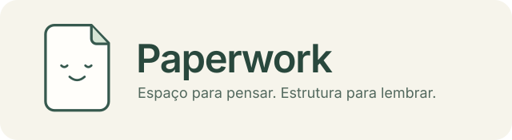

<p align="center"></p>

<p align="center"><strong>Português (Brasil)</strong> · <a href="README.en.md">English</a></p>

Paperwork conecta anotações em papel ao seu espaço de conhecimento no **SilverBullet 2.11.1**. O fluxo preserva o original, organiza a transcrição para revisão e incorpora o conteúdo às notas existentes. Você pode usar transcrição manual ou configurar um provedor de IA.

O projeto reúne diário, referências Zotero e documentos digitalizados em um fluxo acompanhado pelo usuário. A escrita digital e o conteúdo manuscrito revisado usam as mesmas páginas `Daily/AAAA-MM-DD`. IDs estáveis, revisão explícita e registro de origem ajudam a manter a continuidade das notas.

A implementação usa **Go** no servidor, **TypeScript** como fonte da interface e Space Lua na integração nativa. O Paperwork pode funcionar de forma independente ou compartilhar conexões com o Relay.

**Estágio atual:** MVP experimental. A validação automatizada usa documentos e serviços simulados; a qualidade de reconhecimento de manuscritos pessoais e o funcionamento em todas as plataformas ainda não estão comprovados. Toda incorporação requer revisão.

## Começar a usar

Recarregue o SilverBullet após instalar/atualizar a biblioteca. Na paleta de comandos:

1. Abra **Paperwork: Configurações** e selecione a IA (ou transcrição manual).
2. Abra **Paperwork: Inbox**. Escolha um PDF multipágina, PNG, JPG ou WebP e clique em **Importar original**, ou clique em **Abrir câmera / fotografar página**.
3. Abra o documento na Inbox. O original e a área de transcrição aparecem lado a lado.
4. Clique em **Transcrever com provedor configurado**. Para serviço externo, autorize esse documento. Acompanhe em **Consultar processamento** e depois **Carregar proposta existente**.
5. Confira o texto, a data, os filhos e as pendências. Use **Interpretar e revisar** depois de corrigir o texto.
6. Marque **Revisei a transcrição e a estrutura propostas** e clique em **Incorporar nos diários e notas**.

A proposta não muda suas notas antes da incorporação. Repetir a mesma incorporação concluída não duplica blocos nem recria uma página que você moveu. Alterar a árvore de um documento já incorporado exige reconciliação manual nesta versão.

### Câmera dentro do SilverBullet

Na Inbox, **Abrir câmera / fotografar página → Ligar câmera → Fotografar → Importar foto**. Autorize a câmera no navegador. Há uma prévia antes de importar; fotografar não envia o documento à IA. A câmera é encerrada depois da captura ou ao fechar o painel.

O acesso direto depende de HTTPS ou localhost e de suporte/permissão do navegador. O seletor alternativo solicita a câmera traseira nativa no celular; se o navegador não oferecer câmera, ele permite escolher uma foto já salva. Permissões do aplicativo/PWA também podem precisar ser liberadas no sistema.

Cada foto importada é um original independente. Para preservar contexto de diário entre várias folhas em um só processamento, use **um PDF multipágina**. Esta versão não reúne automaticamente fotos em PDF e não faz recorte, correção de perspectiva ou scanner multipágina.

Limite: **18 MB por arquivo**. Originais enviados por arquivo não são recomprimidos. A câmera codifica o quadro capturado em JPEG; esses bytes são preservados após a importação.

### Escolher a IA

O seletor oferece:

| Opção | Credencial | Configuração |
|---|---|---|
| Sem IA | Nenhuma | Cole ou escreva a transcrição |
| Google Gemini | `gemini_key` | Identificador de modelo capaz de ler imagem/PDF |
| Anthropic Claude | `claude_key` | Identificador de modelo com a capacidade necessária |
| ChatGPT / OpenAI (API) | `openai_key` | Identificador de modelo multimodal compatível com Responses |
| Outro compatível com OpenAI | `compatible_key`, quando exigida | Endpoint `/v1` e modelo com visão/JSON |
| Modelo local / Ollama compatível | `local_key`, quando exigida | Endpoint `/v1` e modelo com visão/JSON |

As opções usam **APIs**, não a sessão do navegador de ChatGPT/Claude/Gemini. Informe sua chave de API no campo correspondente e salve-a; depois selecione o provedor, informe o modelo e salve as configurações. A escolha não faz chamadas nem gera uma cobrança de teste. Os modelos não são fixados automaticamente, pois disponibilidade e capacidades dependem do provedor/conta.

Os campos de modelo e endpoint lembram os perfis salvos ao alternar. Chaves ficam em arquivos privados do servidor, fora do Markdown e sem serem retornadas ao navegador. Compartilhamento com Relay reutiliza as conexões SilverBullet/Vikunja/Zotero; não substitui suas credenciais.

Documentos começam como somente locais. Para APIs externas, habilite **Permitir provedores externos** nas configurações e confirme o envio na revisão do documento. Um endpoint em outro host também exige essa autorização conservadora, mesmo em rede privada. Sem IA configurada, importação, transcrição manual, busca e consulta continuam funcionando.

## PFM: o markup para escrever à mão

Você não precisa desenhar formulários nem usar papel especial. Os marcadores ajudam o parser; em papel livre, atribua a data ou o título na revisão. A IA transcreve, mas não deve inventar datas, relações ou identificadores.

| Escreva | Significado |
|---|---|
| `// 2026-11-01` | Começa um segmento no diário dessa data |
| `//end` | Encerra o segmento; uma nova data também encerra o anterior |
| `• texto` ou `- texto` | Bullet comum |
| Recuo | Bullet filho; o mesmo recuo indica irmãos |
| `> • texto` | Filho explícito, mesmo escrito junto à margem |
| `>> ? texto` | Neto explícito |
| `□ fazer algo` | Tarefa aberta |
| `× T00001` | Atualização de conclusão de tarefa local identificada |
| `! ideia` | Ideia importante |
| `? pergunta` | Pergunta |
| `@tese` | Projeto, ligado a `Projects/tese` |
| `@@ana` | Pessoa, ligada a `People/ana` |
| `#memoria` | Tag/conceito |
| `Ƶ Silva24-Mem p.12` | Obra Zotero por alias; página opcional |
| `:: Título` e `::end` | Começa/encerra uma nota independente |
| `\> literal` | Escapa um marcador estrutural no início da linha |
| `//continue ID` | Continuidade explícita; ainda exige resolução manual |

Use nomes curtos sem espaços para projetos e pessoas: `@projeto-tese`, `@@ana-silva`. `@tese` continua significando projeto; `@@ana` não é interpretado como projeto. Pessoa e projeto geram links nativos separados, aproveitando os backlinks do SilverBullet. Tags, projetos, pessoas e referências são herdados pelos filhos quando não há substituição explícita. E-mail como `ana@example.org` não é uma menção de projeto. Os marcadores de menção precisam estar no início do texto ou após espaço; outros usos de `@` permanecem texto.

```text
// 2026-11-01
• Leitura Ƶ Silva24-Mem p.12 @tese #memoria
   • Argumento principal do autor
> ! Minha interpretação
>> ? Qual é a evidência?
• Conversa @@ana @tese
> □ Preparar roteiro da próxima entrevista
//end

:: Ideias para um ensaio
Texto livre de uma nota independente.
::end
```

O prefixo explícito `>` define profundidade: um `>` é filho, dois são neto. Recuo e prefixo conflitantes, datas inválidas e filhos sem pai entram em revisão. Texto sem novo bullet continua o anterior; não se deve reparentear silenciosamente. Um segmento pode atravessar páginas do **mesmo PDF**. Datas diferentes vão para suas respectivas Dailies, não para a data em que o OCR foi executado. Para transcrição manual de várias páginas, separe-as com uma linha `---PAGE---`.

## Zotero: identificador curto para escrever no caderno

A [extensão desktop complementar](zotero/README.md), neste mesmo repositório, cria um alias como **`Ƶ Silva24-Mem`**. Ela preserva a identidade Zotero real, acrescenta `Paperwork Alias: Silva24-Mem` ao Extra após confirmação e oferece cópia do índice para o Paperwork.

Baixe o [XPI para Zotero 7](zotero/dist/paperwork-zotero-0.2.0.xpi?raw=true), instale pelo gerenciador de extensões do Zotero e siga o [passo a passo](zotero/README.md). No SilverBullet, **Paperwork: Importar identificadores do Zotero** recebe o índice JSON. **Paperwork: Abrir Literature Note** importa/abre a nota do alias e associa o link nativo. Na instalação com Relay, a mesma biblioteca pessoal reutiliza o importador e as notas existentes.

O alias é persistente, não uma citation key do Better BibTeX. Sufixos numéricos resolvem colisões; um alias existente nunca é reassociado automaticamente. Zotero continua sendo a autoridade bibliográfica. Para outra máquina, transfira também o backup de reservas do complemento, descrito no README dele.

## Tarefas e retorno ao papel

As tarefas manuscritas recebem IDs locais próprios e podem ser usadas sem Vikunja. Depois de revisar, use **Exportar tarefas revisadas ao Vikunja** e informe o projeto remoto. Apenas filhos que são tarefas viram subtarefas; comentários e perguntas não viram tarefas.

Os símbolos `□` são preservados em vez de criar checkboxes nativos que disparariam uma segunda exportação pelo Relay. **Paperwork: Tarefas locais** permite consultar, concluir e imprimir uma folha com IDs. Depois, uma captura com `× T00001` permite revisar a conclusão sem alterar o scan original. A versão atual tem exportação/reconciliação manual; não tem sincronização bidirecional automática.

## Onde ficam os dados

O serviço guarda originais imutáveis por SHA-256 em `$PAPERWORK_HOME/originals/`; o nome original e os metadados ficam em `$PAPERWORK_HOME/paperwork.sqlite`. As páginas incorporadas são Markdown comum **no seu Space**. O SQLite guarda o índice e o histórico operacional; não substitui o diário Markdown por outro diário oculto.

No pacote Docker independente, `$PAPERWORK_HOME` é `/paperwork`, montado de `runtime/paperwork`. No pacote combinado, conexões vêm do Relay, mas o serviço Paperwork permanece separado. As notas documentais ficam em `Paperwork/Documents/`; notas independentes em `Paperwork/Pages/`. Na revisão, **Abrir original preservado** abre o arquivo autenticado.

**Paperwork: Criar backup** captura banco, originais e notas com manifesto e hashes. O serviço é Go; banco e originais devem permanecer em volume persistente.

## Implementação e instalação

Backend e ferramentas: **Go**. Interface: **TypeScript compilado** e Space Lua nativo. Não há código ou dependência Python no pacote. O JavaScript em `Library/Scripts` e `zotero` é gerado para execução no SilverBullet/Zotero e marcado como artefato no GitHub.

Daily e Zotero pertencem ao Paperwork: comandos **Daily: Abrir hoje**, **Vikunja: Sincronizar Daily atual**, **Zotero: Buscar biblioteca** e `/cite`. Conexões compartilhadas com Relay são opcionais. A configuração independente aceita `timezone`, SilverBullet URL/token, `vikunja` URL/token/Inbox e `zotero` user_id ou group_id/key_file. Ative os jobs explicitamente em `enabled.daily` e `enabled.zotero`; intervalos são `daily_interval` e `zotero_interval`, em segundos. Ambos começam desativados nos exemplos.

Requer Go 1.26+ e Node.js para construir TypeScript (Node com execução nativa de TypeScript para os testes). No checkout:

```sh
npm ci
npm run build
npm run test:zotero
go test -p 1 ./...
go build -o bin/paperwork ./cmd/paperwork
go build -o bin/paperwork-state ./cmd/paperwork-state
go build -o bin/sb-tools ./cmd/sb-tools
bin/sb-tools package --kind paperwork --source . --binary bin/paperwork --destination /caminho/novo
bin/sb-tools bootstrap --package /caminho/novo
```

O pacote gerado contém Dockerfile, Compose, bibliotecas e binário Go. Configure acesso ao Space e os arquivos de credenciais antes de habilitar jobs. O servidor usa loopback `127.0.0.1:8089`; `PAPERWORK_HOME`, `PAPERWORK_CONFIG` e `PAPERWORK_LISTEN` permitem outros caminhos. Os tokens nunca são retornados ao navegador.

Em instalação combinada, mantenha Relay e Paperwork em checkouts irmãos. O Relay encaminha rotas legadas Daily/Zotero ao Paperwork e não inicia seus jobs. O pacote compartilhado usa `PAPERWORK_RELAY_CONFIG` e `PAPERWORK_RELAY_SETTINGS` apenas para conexões. Não execute workers antigos e novos sobre o mesmo estado.

### Migração de estado

Faça uma captura SQLite consistente com os workers parados. `paperwork-state --source SNAPSHOT` mostra contagens sem conteúdo. Para transferir a uma biblioteca existente use `--destination BIBLIOTECA --workers-stopped`. IDs, hashes e valores são preservados em tabelas `relay_*`, separadas das tarefas manuscritas. A condição dos workers deve ser conferida pelo operador: a flag não consulta processos externos. Reversão exige reconciliar qualquer estado novo; não restaure snapshots antigos sobre bancos ativos.

### Verificações

Os testes Go incluem fixtures sintéticas do parser anterior, armazenamento, configuração independente/compartilhada, Daily idempotente, mapeamentos Zotero e retenção de checkpoint em conflito. `npm run test:camera` usa Chromium e câmera simulada; defina `CHROMIUM_PATH` se necessário. Qualidade de OCR de manuscritos pessoais depende do material/provedor e ainda não está comprovada.

O pacote inclui uma cópia da biblioteca padrão nativa `Std`, alinhada à imagem SilverBullet 2.11.1. Ela fornece as APIs Space Lua usadas pelos comandos e widgets; instalar apenas o backend não registra a interface. Recarregue o cliente após atualizar as bibliotecas.
